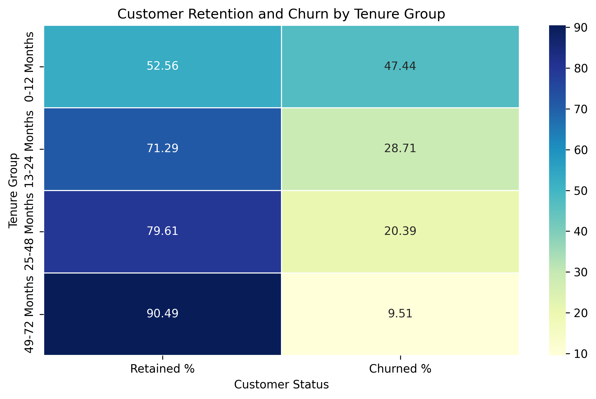

# Customer Cohort & Churn Analytics

## Project Overview

This project focuses on analysing customer churn behaviour in the telecommunications industry using the IBM Telco Customer Churn dataset.

The main objective is to understand why customers leave the company, identify high-risk customer segments and suggest strategies to improve customer retention.

## Dataset Information

- **Dataset:** IBM Telco Customer Churn
- **Total Customers:** 7,043
- **Total Columns:** 21
- **Target Column:** Churn

The dataset contains customer details, subscribed services, tenure, contract types, payment methods and billing information.

## Tools & Technologies

- Python
- Jupyter Notebook
- Pandas
- NumPy
- Matplotlib
- Seaborn
- Plotly
- Power BI Desktop

## Data Cleaning

The following data preparation steps were performed:

- Loaded and inspected the dataset using Pandas.
- Checked column names, data types and missing values.
- Converted `TotalCharges` from object to numeric.
- Identified 11 blank values in `TotalCharges`.
- Replaced those 11 missing values with 0 because the affected customers had zero tenure.
- Verified that no missing values remained.

## Exploratory Data Analysis

The following analyses were performed:

1. **Baseline Churn Rate:** Calculated the percentage of customers who left the company.
2. **Churn Distribution:** Compared retained and churned customers.
3. **Customer Tenure Analysis:** Studied how long customers stayed with the company.
4. **Contract Analysis:** Compared churn across month-to-month, one-year and two-year contracts.
5. **Payment Method Analysis:** Examined churn across different payment methods.
6. **Monthly Charges Analysis:** Compared average monthly charges of retained and churned customers.
7. **High-Risk Segment Analysis:** Identified customer groups with higher churn rates.
8. **Retention Analysis:** Created a tenure-based retention matrix and heatmap.

## Key Findings

| Analysis | Key Finding |
| Baseline Churn Rate | 26.54% |
| Highest Tenure Churn | 0–12 months: 47.44% |
| Highest Contract Churn | Month-to-month: 42.71% |
| Highest Payment Method Churn | Electronic check: 45.29% |
| Average Monthly Charges | Churned: 74.44; Retained: 61.27 |
| Highest-Risk Segment | New month-to-month customers: 51.35% churn |

## Visualisations

The project includes:

- Customer Churn Distribution Chart
- Customer Tenure Analysis
- Tenure-Based Retention Matrix
- Customer Churn Heatmap

## Retention Recommendations

Based on the analysis, the following recommendations are suggested:

- Focus on retaining customers during their first 12 months.
- Encourage month-to-month customers to consider longer-term contracts.
- Promote automatic payment methods.
- Investigate billing concerns among electronic-check customers.
- Review higher-priced plans and improve the value offered to customers.
- Provide better onboarding and customer support to high-risk segments.

## Project Files

| File | Description |
| `telco_customer_churn.csv` | Original customer dataset |
| `Datheon_Task_3_Customer_Cohort_Churn_Analysis.ipynb` | Python code and analysis |
| `README.md` | Project overview, findings and recommendations |
| `Churn_Heatmap.png` | Customer retention and churn heatmap |

## Conclusion

The analysis shows that customer churn is strongly associated with tenure, contract type and payment method. New customers, month-to-month contract customers and electronic-check users have comparatively higher churn rates.

The findings can help businesses identify customers who may need additional support and develop better customer retention strategies.

---

**Internship:** Datheon – Data Analytics & Power BI Internship

**Task:** Task 3 – Customer Cohort & Churn Analytics
