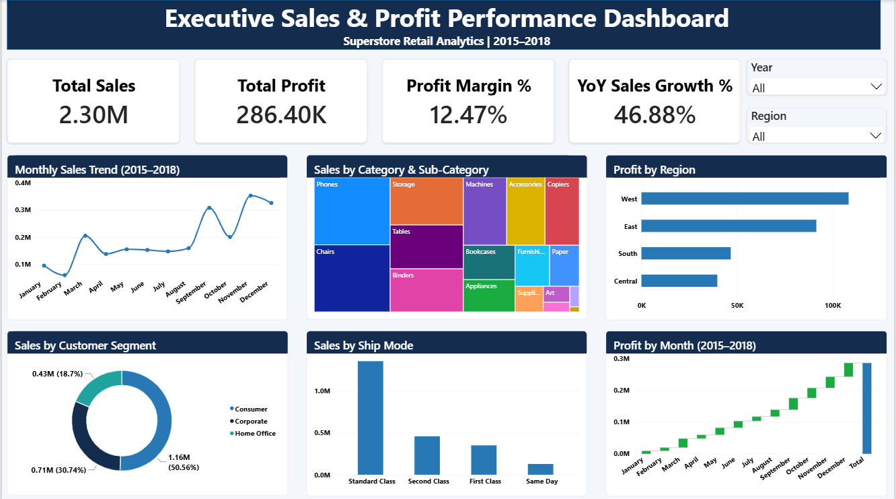

# Task 2 – Executive Sales & Profit Performance Dashboard

## Project Overview
This project is part of the Datheon Data Analytics & Power BI Internship.

The objective is to develop an interactive Executive Sales and Profit Dashboard using Microsoft Power BI to analyse Superstore retail sales performance.

## Tools & Technologies
- Microsoft Power BI Desktop
- Power Query
- DAX (Data Analysis Expressions)
- CSV Dataset

## Dataset
Superstore Retail Sales Dataset containing order, customer, product, sales, profit and shipping information.

**Dataset period:** 2015–2018

## Dashboard Features

### Key Performance Indicators (KPIs)
- Total Sales
- Total Profit
- Profit Margin %
- YoY Sales Growth %

### Visualisations
1. Monthly Sales Trend – Line Chart
2. Sales by Category & Sub-Category – Treemap
3. Profit by Region – Clustered Bar Chart
4. Sales by Customer Segment – Donut Chart
5. Sales by Ship Mode – Clustered Column Chart
6. Profit by Month (2014–2017) – Waterfall Chart

### Interactive Filters
- Year Slicer
- Region Slicer

## Data Modelling
The project uses a star schema consisting of:
- Fact Orders
- Dim Customer
- Dim Product
- Dim Date

## Key Skills Demonstrated
- Data Cleaning and Transformation
- Data Modelling
- DAX Measures
- Interactive Dashboard Development
- Data Visualisation
- Business Insights

## Project Deliverables
- Power BI Dashboard (.pbix)
- Dashboard Screenshot (.png)

## Dashboard Preview

## Internship
**Organisation:** Datheon  
**Programme:** Data Analytics & Power BI Internship  
**Task:** Task 2 – Interactive Power BI Dashboard
